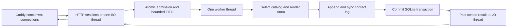

# Request pipeline and worker design

Implementation and review reference for November 5, 2026. This specifies the implemented handoff from concurrent Caddy connections to one processing worker, the return path, and the interfaces used by tests. See the [server design](DESIGN.md), [census database](DATABASE.md), and [test plan](TEST-PLAN.md).

Use message passing through a bounded FIFO in shared memory. One thread runs the asynchronous network event loop, and one worker consumes request messages in admission order. The worker posts completed results to the event loop. A request's admission slot remains reserved through processing and delivery, including a result waiting for its network callback.

The Atom writer is a synchronous function that can be tested directly. The listener, queue, processor, and writer compose into the same pipeline used by integration tests and the final service.

## Threads and ownership

The main thread runs one Boost.Asio `io_context`. A `std::jthread` runs the worker. A third, temporary loader thread exists only while preparing a catalog replacement. There is no thread per connection and no general-purpose thread pool.

| Owner | Objects and permitted work |
| --- | --- |
| I/O thread | Acceptor, sockets, Beast parsers and messages, session timers, signals, systemd notifications, and network writes |
| Worker | Active catalog, feed generation for requests, SQLite connection and statements, contact log, and bounded database maintenance |
| Loader | Candidate catalog parsing, validation, and feed-size preflight; no live database, log, or socket access |
| Shared under one short mutex | FIFO operations, admission count, request processing phases, cancellation, stop state, candidate handoff, and copied health information |

Only the I/O thread operates on a socket, including closing or cancelling it. Beast streams require serialized access; using one `io_context::run()` thread supplies that serialization. If multiple I/O threads are introduced later, sessions will need strands. [Beast stream thread safety](https://www.boost.org/latest/libs/beast/doc/html/beast/ref/boost__beast__tcp_stream.html)

No catalog parsing, XML generation, database operation, contact-log write, or blocking wait for a worker result runs on the I/O thread. The worker releases the shared mutex before doing those operations, posting completions, or invoking any test hook.

## Interfaces independent of sockets

Split HTTP framing from the application's request values. The public declarations are in `request.hpp`, `processor.hpp`, `worker.hpp`, and `http_server.hpp`.

| Type or operation | Contract |
| --- | --- |
| `CheckRequest` | Owns a normalized 16-byte UUID and canonical suite ID. It contains no Beast object, socket, borrowed target string, or client address. |
| `RequestContext` | Internal request sequence, wall-clock admission time, monotonic admission time, and monotonic queue deadline. |
| `Reply` | Application outcome of success, unknown suite, or unavailable, with an owned UTF-8 Atom body on success and a coarse error category otherwise. |
| `Completion` | Request sequence, owned reply, and the admission lease needed to finish delivery. |
| `CompletionPort` | A thread-safe, non-waiting operation that queues one completion for delivery on the receiver's executor. It never calls a session directly on the worker thread. |
| `RequestWorker::try_submit(request, port)` | Returns an accepted submission handle, busy, or stopping. It never waits for capacity or processing. |
| `RequestWorker::cancel(handle, reason)` | Cancels a queued or preparing request when permitted by its phase. Reports whether cancellation won the race. |
| `RequestWorker::begin_shutdown()` | Stops admission, removes unstarted work, and wakes the worker. |
| `RequestWorker::status()` | Returns a small copied status snapshot; it exposes no catalog or SQLite references. |
| `CheckProcessor::process(request, context, gate)` | Synchronous processing of one admitted request, including the persistence gate described below. Only the worker calls it in production. |
| `render_feed(catalog, request, options)` | Synchronous selection and bounded XML generation. It reads an immutable catalog and returns owned bytes or an error. It has no census, clock, socket, or thread side effects. |

Keep `CompletionPort` a small adapter, such as an owning callable, rather than introducing a messaging framework. The production adapter captures an I/O executor and a weak session reference. It uses `boost::asio::post(executor, ...)`; the posted handler checks whether the session still exists before delivering its result. A test adapter queues the same completion in a manually driven mailbox. [Asio post](https://www.boost.org/latest/doc/html/boost_asio/reference/post/overload2.html)

Use separate injected wall and monotonic clocks. `try_submit` captures both at successful admission, before the request waits in the FIFO. The wall time supplies the log timestamp and UTC census day. Queue deadlines and health checks use only monotonic time, so changing the wall clock cannot extend or expire a queued request.

## FIFO admission

Use `std::deque<Job>`, `std::mutex`, and `std::condition_variable`. The mutex protects admission and queue transitions. A job is an owning envelope containing its request, context, completion port, shared cancellation control, and admission lease.

Submission performs the following operation:

1. Prepare the small owning request/control objects.
2. Lock the shared mutex. Reject if stopping or if the number of admitted unfinished requests has reached its limit.
3. Assign the next internal sequence and admission timestamps, and append the complete job to the FIFO.
4. Reserve its admission slot as part of the same successful operation.
5. Unlock, then notify the worker.

Make insertion exception-safe: a failed allocation must not consume a slot or leave an accepted handle without a job. No user callback runs under the mutex. Lease destruction that takes the mutex must occur after unlocking.

The worker waits on the condition variable while there is no request or control work. It removes the front job under the mutex and marks its processing phase before unlocking. Spurious wakeups recheck the predicate. Stop and candidate handoff also notify this wait.

FIFO means order of successful admission, which is the sequence assigned under the mutex. TCP connection order and the order clients begin sending are not meaningful ordering guarantees. No later admitted check-in overtakes an earlier live check-in. Cancelled and expired jobs are skipped, and catalog activation may occur between check-ins.

The queue API remains safe for concurrent producers even though the initial production listener has only one I/O thread. Tests will submit simultaneously from multiple threads and compare execution against assigned admission sequences.

## Capacity and admission lifetime

Keep two independent limits:

| Limit | Initial value | Covers |
| --- | --- | --- |
| Backend sessions not yet retired | 128 | Pending accepts, header reads, small error replies, queued/running checks, response writes, and their cancellation callbacks |
| Admitted unfinished check-ins | 64 | Queued jobs, active processing, posted completions, and responses still owned by a write operation |
| Atom payload per response | 512 KiB | Entire serialized success body, enforced before persistence |
| Non-feed error or health body | 1 KiB | Small replies that do not use a check-in slot |

The capacity check uses the unfinished count, not the deque length. A slow writer consumes a connection and an admission slot without occupying the worker.

One reference-counted `AdmissionLease` represents one reservation. Successful admission increments the count once; copying its `shared_ptr` does not reserve another slot. Its last owner releases the reservation. Queue envelopes, active processing, posted completions, and network writes hold the lease while they can retain request or response resources.

The session also holds the lease after successful admission. If the session closes, active processing still owns its lease. If processing finishes first, the posted completion owns the lease until the I/O callback either transfers the reply to a session or discards it. A write retains the lease until its completion handler has released the response storage, even after a socket close.

The lease references a small shared capacity state that owns no queue or sessions. This avoids an ownership cycle. Queue timers and cancellation handles use weak control references and do not prolong the lease. Do not run a lease destructor under the capacity mutex; move erased jobs out of the critical section before releasing them.

Remove a cancelled queued job from the deque under the mutex. A linear search across at most 64 jobs is sufficient. Leaving cancelled entries in the deque while releasing their capacity would allow repeated cancellation to accumulate stale entries.

At most 64 success bodies can be retained across processing, posted completions, and writes. At 512 KiB each, that is at most 32 MiB of response payload, plus allocation overhead, request buffers, catalogs, and other service state. Move bodies into Beast messages; do not make a second complete copy. This is a payload bound, not a bound on total process memory.

Reserve a connection slot when creating a session for an accept. When all 128 slots are occupied, pause accepting until a session fully retires. Its reservation lasts through any outstanding asynchronous callbacks, including after a socket close; closing the socket alone does not free buffer capacity. Additional connections remain subject to the kernel backlog and Caddy's connection timeout. A parsed request that cannot acquire a check-in slot receives a small `503` reply with `Retry-After: 30`; it never enters the worker or census.

## Processing phases and cancellation

Track processing and delivery separately. Processing has phases `queued`, `preparing`, `persisting`, and `finished`. Delivery can still be waiting or writing after processing is finished. All cross-thread phase changes and cancellation checks use the queue mutex.

| Event | Transition and effects |
| --- | --- |
| Worker claims a live job before its queue deadline | `queued -> preparing` |
| Queue expiry wins before claim | Remove the queued job; return unavailable; no log or SQL effects |
| Known connection closure before claim | Remove the queued job; discard delivery; no log or SQL effects |
| Cancellation while preparing | Set cancellation; the worker exits before the persistence gate; no log or SQL effects |
| Worker passes the persistence gate | Atomically check cancellation and change `preparing -> persisting` |
| Cancellation after that gate | Finish the log/SQL sequence; suppress delivery if the session has gone |
| Processing ends | `finished`; transfer or release its lease with the completion |

The persistence gate is the precise boundary for the race between cancellation and durable work. If cancellation obtains the mutex first, no contact is recorded. If the worker obtains it first and enters `persisting`, the operation is allowed to complete. Do not inspect a stop token between the log append and SQL commit and abandon a partially executed sequence.

The queue timer and worker use the same deadline and phase checks. Equality with the deadline means expired. If the I/O timer removes a queued job, it owns the one timeout reply. If the worker removes an already expired job first, its completion owns that reply. A losing timer does nothing; it cannot send a second response or overwrite a running job's result. Once a job is preparing, the queue timer is no longer a processing timeout.

TCP does not guarantee prompt knowledge that a caller has abandoned a request. Cancellation uses observed connection errors, local closure, deadlines, and shutdown; correctness does not depend on detecting every remote departure before persistence. An orderly EOF after a complete HTTP request can be a client half-close and is not, by itself, evidence that the response should be cancelled. A contact may commit even when the caller never receives its response.

## One worker operation

For each live job, execute these steps outside the queue mutex except for the brief persistence-gate transition:

1. Borrow the active immutable catalog for this job and resolve the suite. An unknown suite returns not-found without contact logging.
2. Select eligible public and matching targeted artifacts, resolve effective track tags, and render the complete Atom body into a capped output sink.
3. If selection or rendering fails, discard the partial body and return unavailable. There are no census effects.
4. Cross the persistence gate, checking cancellation under the mutex.
5. Append and synchronize one complete JSON contact record, rotating the bounded log if necessary.
6. Execute and commit the census transaction using the admission wall time and its derived UTC day.
7. Move the successful body and lease into one completion and queue it to the I/O executor. Continue to the next job without waiting for a socket.

A log failure returns unavailable before SQL. A SQL failure rolls back and returns unavailable; its already synchronized log line remains an attempted contact. Only a committed transaction permits a success reply. The database and log contracts remain those in the existing designs.

The worker is the sole owner of the SQLite connection and contact log. The listener does not wrap either in a mutex and never calls them. Inject recorder and log adapters in processor tests to control failures and observe ordering; production adapters use the real files and database.

Convert expected rendering, log, and SQL failures into unavailable results and keep processing. An unexpected worker exception or failure to post a completion is a service failure: stop admission and report failure to the controller, rather than silently losing the worker or pretending the request completed successfully.

The active catalog can remain a `unique_ptr<const Catalog>`: only the worker uses the active snapshot, and replacement happens between jobs. Feed construction may borrow references during the synchronous call, but the completed response owns all its bytes. A response waiting on a socket does not retain references to an old catalog. Each render owns its XML writer; library initialization happens once before worker or loader use.

Maintain bounded output while serializing, including escaping and extension text. Do not build an unlimited string and check its size afterwards. Candidate preflight uses the same writer on a conservative suite view containing every potentially eligible artifact and tag; the normal writer also enforces the cap.

No success headers or feed bytes are sent before commit. The bounded XML sink writes into owned memory, not directly to a socket.

## HTTP sessions

Each session follows `reading_headers -> awaiting_result -> writing -> closed`. Invalid input takes the shorter `reading_headers -> writing_error -> closed` path.

The I/O controller keeps an owning registry of live sessions, bounded by the connection limit. It keeps a session alive while it awaits a worker, even when no socket operation is outstanding. On closure, remove it from that registry; asynchronous operation handlers retain any session and message storage they still need until their callbacks complete.

Use Beast to read HTTP/1 headers with an 8 KiB header limit and a bounded read buffer, and extract the method and target. A transport-free route function splits the path and optional platform query, validates the UUID and platform IDs, and normalizes the suite as specified in the HTTP contract. The target has a separate 256-byte limit covering the path and query. Reject body declarations and transfer encodings before admitting a check-in; an explicit zero content length is allowed. Do not wait for a body or send a `100 Continue`.

The first version handles one request per connection and replies with `Connection: close`. It does not process a second pipelined request. This makes each session correspond to one possible check-in and avoids per-connection response ordering machinery. Caddy can use overlapping connections to the loopback listener.

Malformed input, disallowed methods, and unknown routes are handled on the I/O thread. Suite existence is resolved on the worker against the catalog active when it starts the job. The private health route reads a copied status snapshot, has no census effects, and does not wait in the check-in FIFO.

The production completion port posts an owning result to the session's I/O executor. It captures the session weakly, so a queued completion cannot resurrect a closed connection. The I/O callback checks the session's state, discards obsolete results, or moves the body into its Beast response and starts one `async_write`.

The response message, body, session, and admission lease stay alive until that write's completion handler runs. Closing a socket cancels operations but does not permit early destruction of a message still borrowed by Beast. No other write starts on that stream while one is pending. [Beast asynchronous message writing](https://www.boost.org/latest/libs/beast/doc/html/beast/ref/boost__beast__http__async_write/overload2.html)

| Deadline | Initial value | Enforcement |
| --- | --- | --- |
| Header read | 5 s | Stream read deadline on the I/O thread |
| Queue wait | 5 s from successful admission | Session timer plus the worker's check when claiming |
| Response write | 10 s | Fresh stream write deadline before `async_write` |
| Expected active operation | 10 s | Worker health budget; not forced interruption of a filesystem or SQLite call |

Disable the old stream read deadline while awaiting worker results; the queue has its own timer. Reset the stream deadline before writing. Beast operation timeouts apply to the configured logical asynchronous operation. [Beast timeout controls](https://www.boost.org/latest/libs/beast/doc/html/beast/ref/boost__beast__tcp_stream.html)

The existing Caddy response-header timeout of 25 seconds leaves nominal room for header reading, queueing, and a healthy worker operation. A blocked filesystem can exceed the expected worker budget; the watchdog handles that failure. An upstream timeout or lost reply does not undo a committed census observation.

## Catalog reload and other control work

Keep check-in messages FIFO and reserve a separate bounded control slot for a candidate catalog. A full check-in queue must not prevent shutdown or reload completion from being handled.

The I/O controller starts at most one loader. Additional reload signals set one coalesced follow-up flag. The loader parses, validates, and performs feed-size preflight, then hands off one owned candidate or a diagnostic result. It never changes the active catalog directly.

At the next job boundary, the worker gives a ready candidate priority over claiming the next check-in. It registers the candidate's suite IDs in a bounded SQLite transaction and swaps the catalog only after commit. Failure retains the old catalog. It posts a small activation result to the I/O controller for health and systemd reload completion. Queued requests therefore select whichever revision is active when they begin processing.

The control slot is cleared by an acknowledgement before another candidate is handed off. Activation does not consume a check-in slot. Processing and persistence never overlap activation.

Tag each load attempt with a generation. A loader deadline marks its generation rejected and prevents a late result from activating. The result carries its monotonic completion time; a result completed before the deadline is not rejected merely because the controller's periodic collection ran later. A timed-out thread may still be inside a blocking read; do not detach it or start replacement loader threads while it remains alive. Keep serving the old catalog, report the reload state, and allow another attempt only after the old loader has finished. The implementation publishes its future result at thread exit, joins the completed thread, then consumes the result. No parser or file operation is joined from an I/O callback while still running. Move candidate pointers under the shared mutex and destroy discarded or replaced catalogs outside it.

Pruning also belongs to the worker. Coalesce a due flag and perform at most one bounded batch between requests, after up to 100 check-ins under sustained traffic or when idle. Use the same progress reporting and SQL limits. Do not put a whole unbounded retention sweep ahead of queued checks.

Under sustained control activity, allow at least one queued live check-in between activations, and at most one maintenance batch between check-ins. Shutdown takes precedence over new activation or maintenance. These rules prevent repeated reloads from indefinitely postponing an admitted request.

## Startup shutdown and watchdog

Startup reads configuration and prepares the initial catalog. The worker opens and validates its database and log, registers initial suites, and reports initialization completion. The I/O thread then begins accepting connections and announces readiness. A startup failure never exposes a partially initialized service.

On SIGTERM:

1. Stop admission, close the acceptor, and close incomplete header readers on the I/O thread.
2. Remove queued checks and send unavailable where delivery is still possible.
3. Drop pending activation and maintenance. Cancel a preparing check at its gate; allow a persisting check or already started activation transaction to finish.
4. Keep the event loop running so worker completions and cancelled writes can release their messages and leases.
5. Drain replies within their write deadlines, close remaining sessions, and wait for worker and loader exit acknowledgements.
6. Release the event-loop work guard, finish pending callbacks, and join exited threads from the outer controller.

The worker closes its own log and SQLite connection. A `jthread` stop request is cooperative; it does not interrupt a blocked system call. The default orderly shutdown budget is 20 seconds and the packaged unit has `TimeoutStopSec=25s`. At the orderly budget, close remaining network delivery while waiting for thread exit. The controller enforces a final process exit five seconds later, and systemd supplies the independent hard limit. Do not block the I/O thread in a join while callbacks are still needed.

Keep a small shared health snapshot: worker phase and phase start, current operation start, active sequence, queued and unfinished counts, last worker progress, completion count, active revision, and reload state. Current operations include check-ins, activation, and maintenance. Advancing phases does not reset the overall operation start. Do not expose UUIDs or full targets in operational health.

An idle worker uses a timed condition-variable wait with a proposed one-second health interval. It acknowledges idle progress itself; the I/O thread cannot fabricate worker progress by cancelling queued jobs. Normal completions, including completed failures, advance worker progress. An active operation older than its 10-second budget or missing worker acknowledgements is unhealthy. Queue saturation with continuing progress is overload, not a stuck worker.

Schedule systemd watchdog notifications on the I/O loop, initially every five seconds with the existing `WatchdogSec=30s` proposal. Send them only while I/O and worker progress are healthy. A stuck I/O loop cannot send its heartbeat, and a stuck worker prevents the I/O loop from sending one on its behalf. Loader rejection alone does not make a healthy server using its old catalog unready.

## Files and dependency boundaries

| File | Responsibility |
| --- | --- |
| `include/updater/request.hpp`, `src/request.cpp` | Owning request/context/reply values; pure UUID and route normalization |
| `include/updater/atom.hpp`, `src/atom.cpp` | Feed selection and capped libxml2 serialization using `Catalog` |
| `include/updater/processor.hpp`, `src/processor.cpp` | One synchronous check, persistence gate, log-before-SQL ordering |
| `include/updater/worker.hpp`, `src/worker.cpp` | FIFO, admission lease, cancellation phases, control slot, progress, and worker thread |
| `include/updater/http_server.hpp`, `src/http_server.cpp` | Asio/Beast acceptor, sessions, timers, completion adapter, and HTTP response mapping |
| `src/main.cpp` and service controller | Startup, configuration, signals, systemd, reload orchestration, and orderly stop |
| `census` and `contact_log` files | Concrete durable adapters with the existing schema and log contracts |

Keep the current `updater-catalog` target. Add an `updater-core` target for request, Atom, processor, and worker functionality, and a thin `updater-http` target for the Boost adapter. The daemon links both. Unit tests link the core; socket tests additionally link the real HTTP adapter. Systemd remains outside the core and is not needed to test a listener.

Core public interfaces contain standard C++ value types and the catalog model. Keep Beast message and executor types inside the HTTP adapter; a completion port hides the scheduling mechanism. A socket test, an offline feed command, and the final daemon therefore use the same selection and processing implementations.

## Automated verification

| Layer | Driver and assertions |
| --- | --- |
| Feed | Call `render_feed` directly with loaded catalogs and UUIDs. Parse output independently and check entries, tracks, targeting, Nil, namespaces, escaping, stable IDs, dates, and exact cap boundaries. |
| Processor | Call the real synchronous processor with controlled log/database adapters. Prove no recording for unknown suites or rendering failure, log-before-SQL, rollback outcomes, and success only after commit. |
| Worker | Submit real typed jobs through the FIFO, using barriers, injected clocks, and a manually drained completion mailbox. No TCP is needed to prove sequencing or cancellation races. |
| Socket adapter | Start the real listener on loopback port zero and use its assigned port. Send concurrent real HTTP requests through the same worker. Check framing, timeouts, response mapping, and socket/message lifetimes. |
| Caddy and service | Start the built daemon with isolated real state, then put a temporary Caddy instance in front of it. Exercise the proxy, actual recording, reload, watchdog, and restart tests in the existing test plan. |

The worker tests must prove the following properties:

1. With one processor blocked at a test gate, simultaneous submitters receive ordered sequences and at most one check is active. Releasing the gate produces processing in successful admission order.
2. A running check counts toward capacity. With all completed results held in the test mailbox, an empty work deque still cannot admit a request beyond the unfinished limit. Finishing one fake delivery releases its submission ownership and completion lease, restoring one slot.
3. A disconnected running request retains its slot until processing and any posted completion have released it. A cancelled queued request is physically removed; repeated submit/cancel cycles cannot grow the deque.
4. Expiry at the exact deadline and races with worker claim produce one result and no recording for expired queued work. A stale queue timer cannot expire a running job.
5. Cancellation immediately before the persistence gate prevents recording. Cancellation immediately after it allows the persistence sequence to finish. Both orderings are forced with barriers rather than probabilistic sleeps.
6. A stalled response write cannot block processing of the next job. Request/response storage remains alive through cancellation callbacks, and all leases are released after shutdown.
7. A candidate activates only between jobs. Queue saturation cannot block its control slot. Bad candidates and activation failures preserve the old revision; queued jobs observe the revision selected at their processing start.
8. Shutdown wakes an idle worker, rejects new submissions, removes queued work, handles preparing/persisting work correctly, and leaves no active leases or callbacks.
9. Idle acknowledgements keep watchdog health current. Stalled I/O, a stalled active worker with an otherwise empty queue, and a non-acknowledging idle worker lose health. Fast failures and overload with progress remain distinguishable from stalls.

Use test hooks only in the test harness and injected adapters. Core interfaces supply clock and completion abstractions, but production routes do not expose fault controls. Real-network tests must not assume every remote disconnect is observable before recording; force the cancellation race directly in the core tests.

Socket tests cover slow/incomplete headers, oversized input, refused bodies, Nil and uppercase UUIDs, concurrent valid requests, unknown suites, a gated saturated worker, queue expiry, a deliberately held write, client half-close, write failure, and shutdown during delivery. Use a controlled stream or write gate to force a slow write deterministically; a small feed may fit in the kernel socket buffer even if the client does not read.

Run the existing normal and ASan/UBSan configurations. Add a separate ThreadSanitizer run for the new queue and cancellation tests where supported; it is a separate build, not combined with AddressSanitizer. The existing catalog test suite remains unchanged in scope.

## Implementation sequence

All five stages below are implemented. They remain the dependency order for reviewing and extending the code.

1. Implement request values, route normalization, feed selection, and bounded Atom output with direct tests.
2. Implement the synchronous processor contracts, FIFO, admission leases, and completion mailbox tests using controlled persistence adapters.
3. Add the thin real socket listener and its loopback tests during the same pipeline implementation phase. Keep it as a reusable component independent of systemd.
4. Complete the real rolling log and SQLite adapters, then run the same processor/worker/socket suites with temporary real state.
5. Add the service controller, candidate activation, systemd supervision, and Caddy acceptance harness.

The listener is therefore exercised early, while the application logic already has the interfaces it will retain in the final daemon. Feed generation is neither implemented inside a socket handler nor duplicated for its tests.
